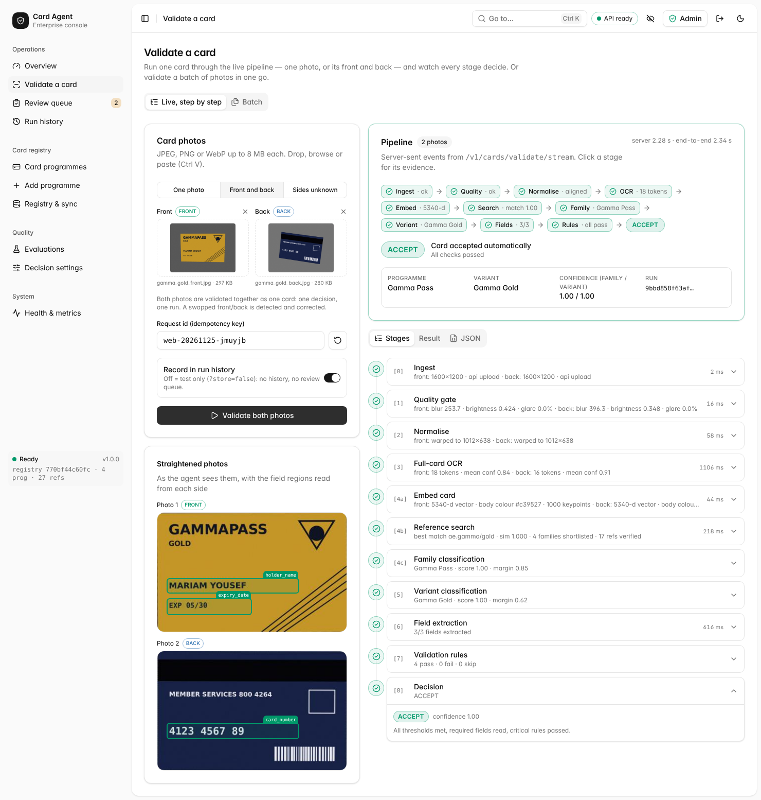

# Card Agent Console — enterprise edition

Web console for the **card-agent-enterprise** API (API v1). It works with result schema 2.0 (`feature/qdrant-platform`) and with schema 2.1 two-sided cards (`feature/two-sided-cards`: front and back photos in one validation). It gives operations, review and platform teams a screen for every operation the service exposes. Those operations are validating cards (with a live step-by-step trace), managing card programmes and their reference images, the human review queue, run history, statistics, runtime decision thresholds, accuracy evaluations, Git registry sync, and health.

It is a thin, typed client: every decision is made by the server. Nothing is simulated in the browser.


| Documentation | |
|---|---|
| [docs/PLATFORM.md](docs/PLATFORM.md) | How the console was built and verified, the architecture, how each API endpoint maps to a screen, the operating procedures, and the security model |
| Backend API reference | `docs/API.md` in card-agent-enterprise, and OpenAPI at `/docs` on the server |

## What it covers

| Area | Screens | API |
|---|---|---|
| Validation | Live validation with **one photo, front and back, or two photos of unknown sides** (SSE timeline with per-photo evidence, straightened photos with field regions per side, JSON); batch validation that pairs `*_front`/`*_back` files | `POST /v1/cards/validate`, `/validate/stream`, `GET /v1/pipeline/steps` |
| Card programmes | List; detail with YAML editor (live schema lint), form editor with **sides** (front only or front + back, per-side required/optional), **field-layout editor per side drawn on a real reference image**, reference images per variant and side, delete; onboarding wizard; YAML import | `/v1/cards…` (GET, PUT JSON/YAML, DELETE, references upload/list/image/delete, `force` for Git-owned cards) |
| Registry | Loaded version and counts, Git sync (prune / re-embed), reload | `/v1/registry`, `/sync`, `/reload` |
| Review | Review queue with keyboard navigation; accept/reject with corrected identification and fields; enrol the photo(s) as references, choosing each photo's side | `GET /v1/review`, `POST /v1/runs/{id}/review` |
| Runs | History with filters and cursor paging; run detail (photo, result, review, JSON); re-validate with current settings; delete; prune | `/v1/runs…` |
| Overview | KPIs, decisions per day, outcomes by programme, top reasons, review load, platform state | `GET /v1/stats`, `/health/ready` |
| Decision settings | Every tunable threshold/weight with defaults and overrides, a merge-patch diff, **what-if evaluation before applying**, reset per section or all | `GET/PATCH/DELETE /v1/settings` |
| Evaluations | Sets (zip upload or built from reviewed runs), runs with live progress, report (gate, precision, agreement, field accuracy, confusion matrix, per-photo rows), comparison with an earlier run | `/v1/evaluation-sets…`, `/v1/evaluations…` |
| System | Readiness, connection, pipeline definition, Prometheus metrics | `/health/live`, `/health/ready`, `/metrics` |

## Two-sided cards (schema 2.1)

Some programmes print data on both sides. Against a 2.1 server the console can:

- **Validate** one photo (unchanged, field `image`), the front and the back (`front` + `back`), or two photos whose sides are unknown (`images`). A rejected `SIDE_REQUIRED:<side>` result offers **Add a photo of the back/front** and re-validates both. If the labels were swapped, the result says "side corrected".
- **Explain** each photo: quality, OCR and embedding per photo in the timeline, the side each field was read from, and the fields that could not be read because their side was not photographed.
- **Define** sides on a programme, assign each field to a side, draw regions on each side's reference image, and manage reference images per side (`missing_references` is shown as a warning).
- **Review** two-photo runs: both photos are shown, and the reviewer chooses which side each photo is enrolled as (`photo_sides`).
- **Evaluate** two-photo cases (`files` in `manifest.json`) and tune `scoring.sides_mismatch_geometry`.

Everything stays backward compatible. One-sided programmes, one-photo validation and their YAML are unchanged, and the console still works against a 2.0 server; the 23-step e2e suite passes against both. Details: [docs/PLATFORM.md §11](docs/PLATFORM.md#11-two-sided-cards-schema-21).



## Quick start (development)

```bash
npm ci
CARD_AGENT_API=http://127.0.0.1:8080 npm run dev     # Vite proxies /v1, /health, /metrics → API (same origin, no CORS)
```
Open http://localhost:5173. Validation works without credentials. Click **Sign in** and enter the server's `CARDAGENT_API__ADMIN_TOKEN` for everything else.

Running the backend locally with demo data:
```bash
# in card-agent-enterprise (feature/qdrant-platform), see its README
export CARDAGENT_EMBEDDER__KIND=classic CARDAGENT_API__ADMIN_TOKEN=dev-admin-token CARDAGENT_QDRANT__PATH=./data/qdrant
python -m uvicorn cardagent.api.app:app --port 8080
# in this repo: two synthetic programmes, references, sample photos, runs, reviews, an evaluation set
python3 scripts/seed_demo.py --enterprise ../card-agent-enterprise --token dev-admin-token --out samples
```
`seed_demo.py` uses the backend's own synthetic test cards. Never point it at production.

## Production deployment

```bash
docker build -f deploy/Dockerfile -t card-agent-console .
docker run -p 8081:8080 -e CARD_AGENT_API=http://card-agent:8080 card-agent-console
```
The image serves the static build with nginx and reverse-proxies the API on the same origin (`deploy/nginx.conf.template`):

- Server-Sent Events are not buffered on `/v1/cards/validate/stream`.
- Uploads up to 520 MB are accepted (evaluation zips).
- Responses carry a strict Content-Security-Policy, `X-Frame-Options: DENY`, `nosniff` and `no-referrer`.
- `/console-health` is the container health check.

If a screen says **"The API address returned a web page instead of the card-agent API"**, the host serving the console is not forwarding `/v1`, `/health` and `/metrics` to the API (for example a plain static host). Use the image above, `npm run dev`, or set the API base URL explicitly.

To serve the console from a different origin than the API instead, set the API base URL in the sign-in dialog and add the console origin to `api.cors_origins` on the server.

## Quality gates

```bash
npm run typecheck   # TypeScript, strict
npm run lint        # oxlint
npm test            # vitest: SSE parser, card schema mirror (incl. sides), front/back file pairing, PII masking, error mapping, metrics parser
npm run build
CONSOLE_URL=http://localhost:5173 ADMIN_TOKEN=... SAMPLES=samples npm run e2e             # 23 end-to-end steps, real browser + real API (2.0 or 2.1 server)
CONSOLE_URL=http://localhost:5173 ADMIN_TOKEN=... SAMPLES=samples npm run e2e:two-sided   # 16 two-sided steps (2.1 server)
```

## Project layout

```
src/api/          client.ts (fetch, token, errors, SSE POST) · sse.ts · endpoints.ts (one fn per operation) · queries.ts (TanStack Query) · types.ts
src/auth/         connection.tsx — base URL, admin token storage, role detection, preferences
src/components/   app-shell (nav, health, Ctrl K palette) · pipeline (live trace, per-photo detail) · photos (per-photo panel, side badges) · card-editor (YAML / form / ROI editor) · reference-manager · review-panel · result-view · common · ui/ (shadcn/ui, Radix)
src/lib/          card-schema.ts (zod mirror of registry/models.py, incl. sides) · pairing.ts (front/back file pairing) · format.ts · use-validation-stream.ts · use-save-card.ts
src/pages/        overview, validate, review, runs, run-detail, cards, card-detail, card-new, registry, settings, evaluations, evaluation-set, evaluation-detail, system
deploy/           Dockerfile, nginx.conf.template
e2e/              console.e2e.mjs, two-sided.e2e.mjs (Playwright, real API)
scripts/          seed_demo.py
docs/             PLATFORM.md, screenshots/
```

Tech stack: React 19 · TypeScript · Vite · Tailwind CSS v4 · shadcn/ui (Radix) · TanStack Query · React Router · CodeMirror 6 · Recharts · zod.
